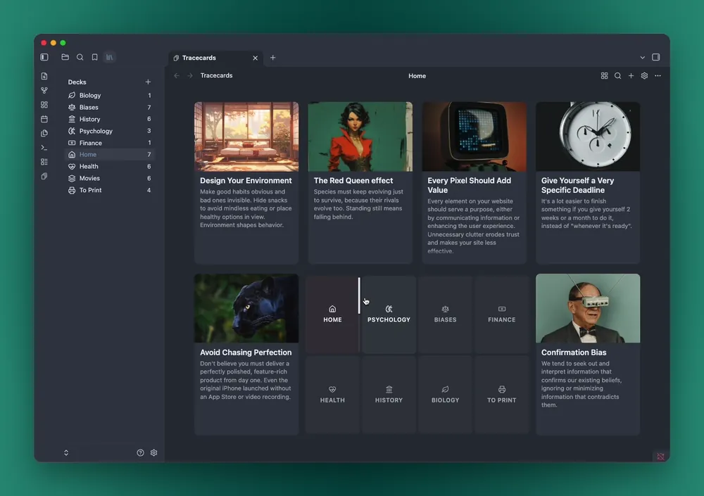

<p align="center">
  <picture>
    <source media="(prefers-color-scheme: dark)" srcset="brand/wordmark-teal.svg" />
    
  </picture>
</p>

<h3 align="center">Instantly recall ideas</h3>

<p align="center">
  A private, visual way to keep your atomic notes in Obsidian: cards with covers, grouped into decks, stored as plain Markdown in your vault.
</p>

<p align="center">
  <a href="https://github.com/visualrecall/tracecards/releases/latest"></a>
  <a href="https://community.obsidian.md/plugins/tracecards"></a>
  <a href="LICENSE"></a>
</p>

<p align="center">
  <a href="https://community.obsidian.md/plugins/tracecards">Install</a> ·
  <a href="https://tracecards.com">Website</a> ·
  <a href="apps/obsidian/README.md">Guide</a> ·
  <a href="spec/vault-format.md">Vault format</a>
</p>

<p align="center">
  
</p>

## Features

- **Cards with covers.** Each card has a cover image, a title, a short description and a Markdown note. Pick a cover from Pixabay's free images or use your own, then move and zoom it right on the card.
- **Decks and the deck pad.** Group cards into decks and keep the ones you use on the deck pad, with six cards around it at a time. Switch to the grid view to see every card in a deck. On a phone, cards show one at a time, with a button to change deck, or as lists of decks and cards.
- **Notes in Obsidian's own editor.** Opening a card shows its note beside the card face, with your theme, vim mode and plugins. A link to another card opens it in place, and Back returns.
- **Bookmarks.** Links and YouTube videos on a card, with their titles and thumbnails.
- **Search.** Find cards by title and decks by name, fuzzily.
- **Canvas.** Put cards on Obsidian Canvas, where they show their face and stay up to date.
- **Printing.** Print a deck at home as a PDF, or order real cards from The Game Crafter in your own account.
- **Keyboard-first.** Everything works without a mouse.
- **Plain files.** A deck is a folder and a card is a Markdown file with YAML frontmatter, so Obsidian, any text editor or git can open them. Whatever syncs your vault syncs your cards.

## Installation

Tracecards needs Obsidian 1.13.2 or newer, on desktop or mobile.

- **From Obsidian:** open Settings → Community plugins → Browse, search for "Tracecards", then install and enable it.
- **Beta versions:** install [BRAT](https://github.com/TfTHacker/obsidian42-brat), choose "Add beta plugin" and enter `visualrecall/tracecards`.
- **By hand:** download `main.js`, `manifest.json` and `styles.css` from the [latest release](https://github.com/visualrecall/tracecards/releases/latest) into `<your vault>/.obsidian/plugins/tracecards/`, reload Obsidian and enable Tracecards in Settings → Community plugins.

## Getting started

1. Open Tracecards from the ribbon (the layers icon) or with the "Tracecards: Open" command.
2. Tracecards keeps its cards in one folder of your vault, `Tracecards` unless you choose another in Settings → Tracecards. If the folder doesn't exist yet, the view offers to create it.
3. Create a deck with a "+" tile on the deck pad or the "+" in the Decks panel.
4. Press Cmd/Ctrl+J for a new card. The first line is its title, and Enter starts the description. Pick a cover, then press Cmd/Ctrl+Enter to save.

| Keys | |
|---|---|
| Cmd/Ctrl+J | New card |
| Cmd/Ctrl+K | Search cards |
| `#` | Search decks |
| Left and right, or h and l | Previous or next deck |
| Space, i or Enter | Select the first card |
| Arrow keys or h j k l | Move between cards |
| Enter | Open the selected card |
| Alt (Option) + arrow keys | Move the selected card |
| r | Switch between the pad view and the grid view |
| Esc | Back to the decks |

Every key, setting and gesture is in the [guide](apps/obsidian/README.md#using-it).

## How your cards are stored

A Tracecards folder holds a subfolder per deck and a Markdown file per card:

```
Tracecards/
├── Product Strategy/             ← deck
│   ├── _deck.md                  ← optional deck settings (icon, order, slot on the pad)
│   ├── Jobs To Be Done.md        ← card
│   └── Second-Order Thinking.md
├── Reading/
│   └── Thinking, Fast and Slow.md
└── attachments/
    └── jtbd-cover.webp
```

`Product Strategy/Jobs To Be Done.md`:

```markdown
---
id: 01JBQ6Z7X8Y9K2M3N4P5Q6R7S8
description: People don't buy products, they hire them to make progress.
cover: "[[jtbd-cover.webp]]"
rank: 1.5
created: 2026-10-28T12:00:00Z
bookmarks:
  - url: https://youtu.be/VIDEO_ID
    title: Talk on jobs to be done
---

The note is ordinary markdown.
```

- The card's title is its file name, and a card belongs to the deck whose folder it's in.
- Tracecards only reads its own folder and never touches your other notes.
- Fields it doesn't know are kept as they are, so you can add your own.
- The search index lives in memory, never in your vault.

Every field is described in the [vault format spec](spec/vault-format.md).

## Network use

The plugin works offline, needs no account and has no telemetry. Bookmarks load images and titles from other sites, and two optional features use services you sign up to yourself:

- **Site icons** for links in the Bookmarks tab come from Google (`https://www.google.com/s2/favicons`), which receives each link's domain, whenever the tab is shown.
- **Video thumbnails** come from YouTube (`https://i.ytimg.com`), in the Bookmarks tab.
- **Video titles** come from YouTube's oEmbed endpoint (`https://www.youtube.com/oembed`), once, when a video is added as a bookmark.
- **Image search**, once you've added a free Pixabay API key: the card form sends what you search for, or the card's title once you've written it, with your key, to Pixabay (`https://pixabay.com/api/`), and loads the results' images from Pixabay. The image you pick is downloaded and saved in your vault.
- **Printing**, once you've added your own Game Crafter API key and pressed "Print…" on a deck: Tracecards sends your cards' images and your key to The Game Crafter (`https://www.thegamecrafter.com`). It creates a game and a cart in your account and opens the cart in your browser, where you add your address, choose shipping and pay. Tracecards never pays for anything and never sees your address. Before each print it deletes the unpaid carts, and their games, left by your earlier prints with Tracecards; it never touches paid orders or anything else in your account. Printing at home as a PDF uses no network.

Your Pixabay key and Game Crafter private key are kept in Obsidian's secret storage on your device and aren't synced. Nothing else is sent anywhere.

## Accounts, payments and files outside your vault

- **Accounts:** Tracecards needs none. Image search needs a free Pixabay account, for its API key, and ordering printed cards needs an account with The Game Crafter.
- **Payments:** Tracecards is free. Printed cards are paid for at The Game Crafter, in your browser, if you order them. Printing at home as a PDF is free.
- **Files outside your vault:** on desktop, "Save PDF" writes the PDF wherever you choose in the save dialog, which can be outside your vault, so you can keep and print it from anywhere. On phones and tablets, the PDF goes in your vault, where attachments go. Tracecards reads and writes nothing else outside your vault.

## Development

You'll need Node 24 or newer.

```sh
npm install
npm run check        # lint, formatting, typecheck and tests
npm run build        # builds the plugin into apps/obsidian/dist
npm run dev          # rebuilds the plugin on every change
npm run dev-vault    # creates dev-vault/, an Obsidian vault with the plugin installed
npm run gen-vault    # adds sample cards to the dev vault
```

Open `dev-vault/` in Obsidian with "Open folder as vault", keep `npm run dev` running, and reload Obsidian ("Reload app without saving") after a rebuild.

```
apps/obsidian/    the plugin
packages/core/    the vault format, decks, cards and search, with no UI
packages/ui/      the React screens
spec/             the vault format spec and its test cases
brand/            the logo
scripts/          the dev vault scripts
```

Dependencies point one way, `apps/obsidian → packages/ui → packages/core`, and `core` imports no React, Obsidian or Node APIs, so the same core runs in Node for tests. The [plugin guide](apps/obsidian/README.md) has more on how it works, and [CONTRIBUTING.md](CONTRIBUTING.md) has the commit conventions.

## License

Copyright © 2026 VisualRecall. The Tracecards plugin for Obsidian is free software: you can use, change and share it under the [GNU Affero General Public License, version 3](LICENSE). If you share a changed version, or let people use one over a network, its source has to be available under the same license.

The [vault format](spec/vault-format.md) and its test vaults in `spec/` are under the [Apache License 2.0](spec/LICENSE) instead, so any app, open or not, can read and write Tracecards vaults.

If the plugin is useful to you, a star helps others find it.
